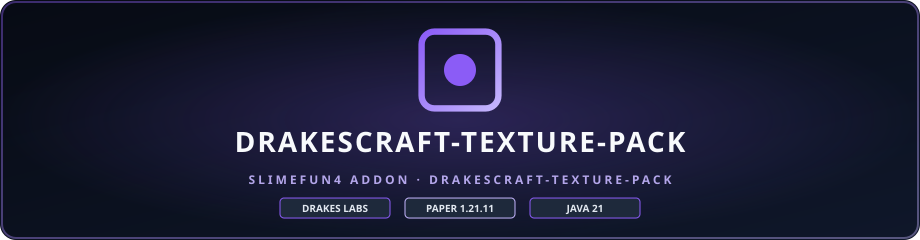
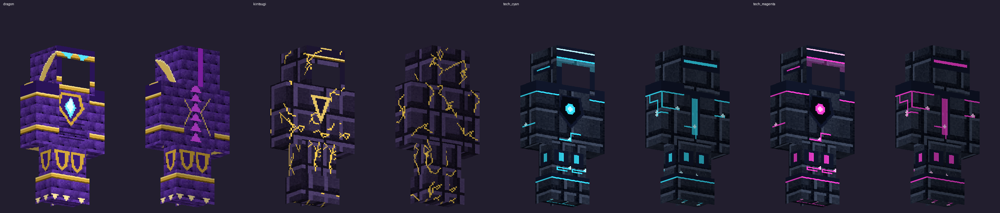
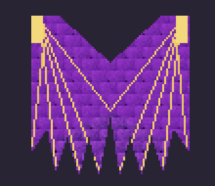
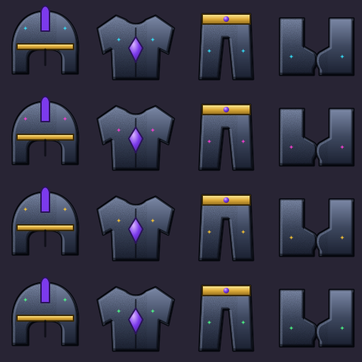
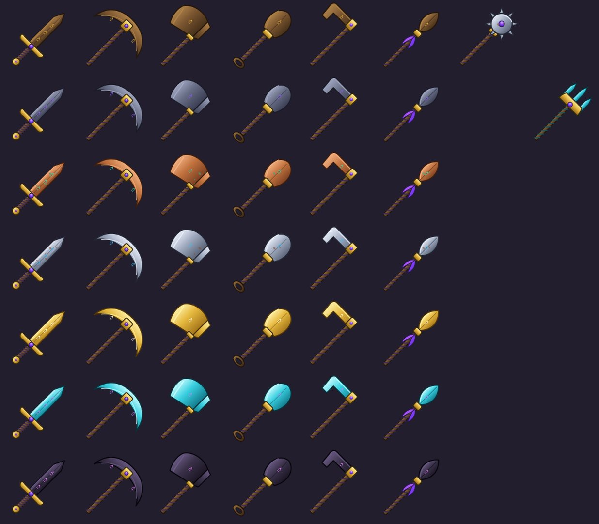
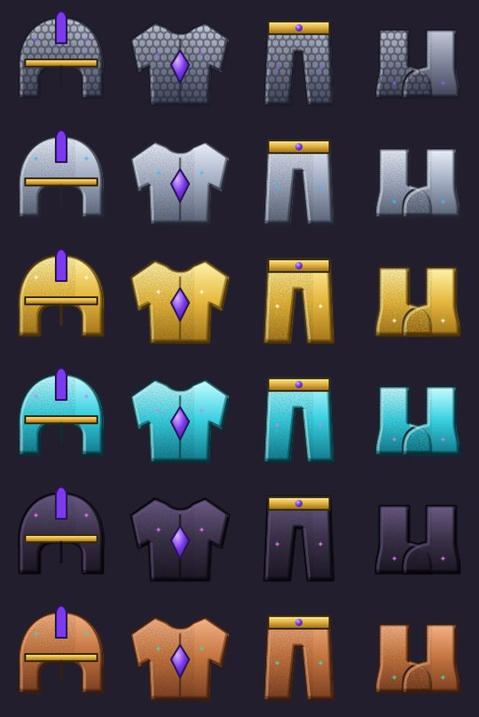
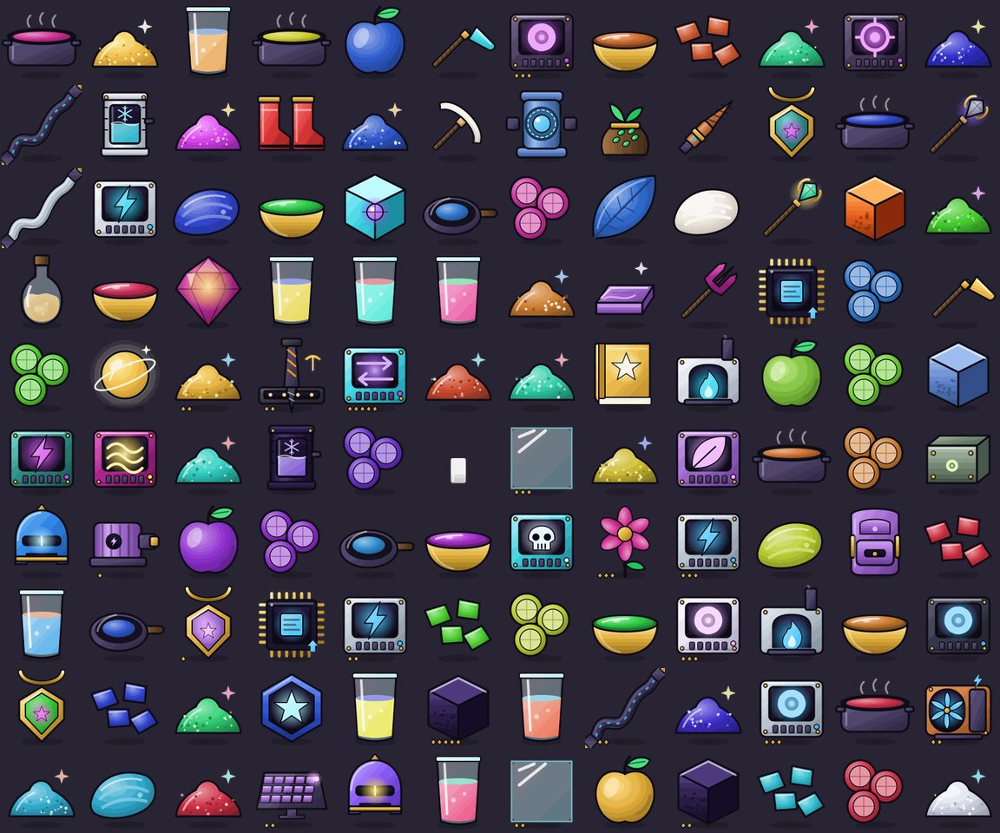
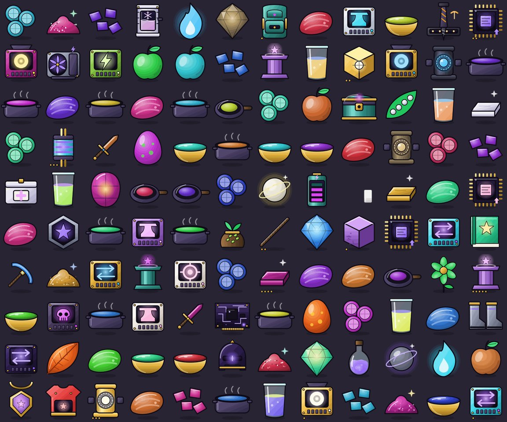

<p align="center">
  
</p>

# DrakesCraft Resource Pack

> ### 🏰 ¡Únete a la Comunidad Oficial de DrakesCraft!
> 
> * 🎮 **IP del Servidor**: `mc.drakescraft.cl` *(Java 1.21.11 & Bedrock)*
> * 💬 **Discord Oficial**: [discord.gg/drakescraft](https://discord.gg/rv3vtXZTk7)
> * 🌐 **Web & Guía**: [web.drakescraft.cl](https://web.drakescraft.cl) — 🛒 **Tienda**: [web.drakescraft.cl/store](https://web.drakescraft.cl/store.html)
> 
> *¡Juega con este addon y más de 80 expansiones optimizadas en vivo en nuestra network de supervivencia técnica!*

---

Repositorio oficial del compilador, reglas de validación y modelos 3D / texturas del paquete de recursos de **DrakesCraft**. Mantenido por **DrakesCraft Labs** para Minecraft 1.21.11.

---

## 🎯 Filosofía y Reglas de Compilación

El paquete de producción se rige por la regla estricta **SF-only**:
- Define modelos y texturas para ítems y bloques de Slimefun mediante `custom_model_data` moderno y predicados de ítems.
- **Prohibición de Overrides Vanilla**: Nunca reemplaza modelos ni texturas vanilla para evitar que bloques ordinarios muestren la textura rota de cuadros magenta y negros en clientes de jugadores.

---

## ⚡ Construcción del Resource Pack

El pipeline de construcción verifica la validez de los JSONs y la integridad de las rutas antes de empaquetar el ZIP final:

```bash
python3 scripts/build_resource_pack.py \
  --base dist/verified-base.zip \
  --output dist/DrakesCraft-resource-pack.zip
```

---

## 🛠️ Entorno

- **Compatibilidad**: Minecraft Java 1.20 a 1.21.11 / Purpur Core 26.2+ (`supported_formats: 15..120`) & Bedrock Edition (Geyser)
- **Herramientas**: Python 3.11+ / Pillow / FFmpeg

---

## 🏛️ Sistema Integral de Overhaul Visual & Sonoro (Noviembre 2026)

El paquete incluye una renovación integral de interfaz, diseño sonoro orgánico y símbolos de servidor:

### 1. HUD & Barras de Estado Soberanas
* **Barra de XP Espectral Arcoíris (`experience_bar_progress.png`)**: Gradiente continuo de alta fidelidad (Rubí $\to$ Naranja $\to$ Oro $\to$ Esmeralda $\to$ Cian $\to$ Zafiro $\to$ Amatista) con base de obsidiana biselada y greca dorada protectora.
* **Hotbar Soberana (`hotbar.png`)**: Fondos en obsidiana cósmica `#101626` con tachonado dorado. Insignias heráldicas talladas en los extremos: ala de dragón de DrakesCraft a la izquierda y estrella de 4 puntas de JackStar a la derecha.
* **Corazones & Burbujas**: Corazones tallados en rubí facetado (`heart/full.png`, `hardcore_full.png`) y burbujas de aire cristalinas etéreas.

### 2. Estaciones de Trabajo, Slimefun Maquinaria & Contenedores
* **Mesa de Crafteo (`crafting_table.png`)**: Flecha de crafteo con energía celeste cian luminosa, greca griega dorada en moldura superior y marco en obsidiana de noche profunda.
* **Mesa Mejorada Slimefun / Dispensador (`dispenser.png`)**: Punto de inicio de la tecnología Slimefun. Cuadrícula 3×3 flanqueada por runas de resonancia cuántica (cian y amatista) y sello estelar de JackStar.
* **Hornos, Ahumadores y Altos Hornos (`furnace.png`, `smoker.png`, `blast_furnace.png`)**: Fuego sagrado celeste en gradiente cian a amatista mística.
* **Cofres de 54 Ranuras (`generic_54.png`)**: GUI unificada de obsidiana pulida con marco de greca dorada, 100% compatible con los menús y almacenes cuánticos de Slimefun.
* **Ender Chest (`ender_chest.png`)**: Ribetes místicos en amatista real sobre panel abisal.
* **Yunques, Mesas de Encantamiento & Tolvas**: Rediseñados bajo la estética clásica helénica-obsidiana para armonía total.

### 3. Insignias Vectoriales de Rangos con Fallback Cero-Cajas (Zero-Box Degradation)
Para evitar caracteres rotos (`[]` o cajas vacías) en jugadores sin paquete de recursos, se implementó el estándar de traducción nativo de Minecraft (`{"translate": "drakescraft.rank.<id>", "fallback": "✦ <RANGO> ✦ "}`).
* **Glifos Oficiales (`\uE140` a `\uE148`)**:
  * `\uE140` ➔ **Owner** (Corona triple dorada sobre púrpura regio)
  * `\uE141` ➔ **Admin** (Escudo heráldico carmesí con gema solar)
  * `\uE142` ➔ **Dev** (Diamante en cian eléctrico y runas binarias)
  * `\uE143` ➔ **Mod** (Mazo de la justicia en esmeralda viva)
  * `\uE144` ➔ **Builder** (Piqueta y cincel en oro ámbar y zafiro)
  * `\uE145` ➔ **Polis** (Columna dórica griega en mármol de Paros)
  * `\uE146` ➔ **Zeus** (Rayo olímpico electrizante en oro puro)
  * `\uE147` ➔ **Streamer** (Prisma magenta de transmisión y orbe radiante)
  * `\uE148` ➔ **SFMaster** (Núcleo de reactor Slimefun en verde lima radiactivo)
* **Compatibilidad Vainilla**: Si un cliente juega sin el paquete de recursos, el motor del cliente sustituye automáticamente el glifo por el texto legible enriquecido sin desfigurar el chat ni la tablist.

### 4. Micro-Diseño de Audio Orgánico y Sutil (Foley)
* **Pasos (`step.*`)**: Pisadas acústicas en hierba mullida, losas de piedra noble, madera cálida, follaje y tintineo delicado de vidrio (30 clips OGG mono 44.1 kHz, ~350 KB totales).
* **Ambiente**: Lluvia suave relajante y brisa de viento en las copas de los árboles.
* **UI**: Clic de botón en madera suave táctil (`ui/button_click.ogg`).

---

## 🖼️ Galería (2026-11-12)

Armaduras puestas (dragón con alas, kintsugi laqueada, tecnológica en 4 colores; cara libre):



Alas del dragón (capa `wings`, salen del molde del cuerpo) e iconos de la armadura tecnológica:

 

Herramientas y armaduras en vector (128 px):




Slimefun por ID (1.624 diseños únicos, 128 px; muestra aleatoria):




Regenerar armaduras: `python3 scripts/gen_armor_v2.py`; vista previa puesta: `python3 scripts/render_armor_preview.py out.png nombre:humanoid.png:leggings.png`. Uso en juego:
`/give @s netherite_chestplate[item_model="drakescraft:tech_cyan_chestplate",equippable={slot:"chest",asset_id:"drakescraft:tech_cyan"}]` (también `dragon`, `kintsugi`, `tech_magenta|gold|green`).

## T2: aislamiento de shaders antiguos (#576)

El pack combinado de T2 es distinto del SF-only de producción. Su shader
`minecraft:core/item` usa sintaxis anterior al cambio a ShaderC/SPIR-V de
[Minecraft 26.3](https://www.minecraft.net/en-us/article/minecraft-java-edition-26-3).
El constructor específico conserva todos sus recursos y mueve los tres shaders
antiguos a `overlay_legacy_shaders`, activo únicamente entre los formatos 64 y 88
(hasta 26.2). Los clientes posteriores usan sus shaders originales. El efecto
adicional de ojos brillantes del pack queda limitado a ese rango antiguo.

```bash
python3 scripts/build_t2_pack.py \
  --base /ruta/al/t2-original.zip \
  --base-sha256 d926125ce9fae17d7544e69b88d68008633c29dc371b13d8a63f6f44a810a643 \
  --output /ruta/al/t2-corregido.zip
python3 -m unittest discover -s scripts -p test_build_t2_pack.py -v
```

El ZIP base se conserva en el respaldo operativo; su hash identifica el ensamblado
previo. El constructor rechaza una base distinta, duplicados o shaders adicionales
en overlays que requieran auditoría. No incorpora los overrides del constructor
SF-only ni modifica modelos, texturas, idiomas o los otros overlays.

También verifica el CRC de todos los miembros antes de abrir la salida: incluso
con SHA-256 coincidente, una base corrupta se rechaza conservando el candidato
anterior. La regresión cubre tanto una salida existente como una ruta nueva.

Para exigir el recurso pendiente de T2, agregar a la reconstrucción:

```bash
--require-model minecraft:item/custom/item/fire_katana
```

La opción es repetible y comprueba el JSON final del modelo en la raíz antes de
crear o reemplazar la salida. Un modelo presente solo en un overlay o una
sustitución mediante `--missing-model-fallbacks` no cumple ese requisito. Se
admiten recursos recuperados mediante `--extra-dir` y se informa el SHA-256 de
cada modelo exigido en `required_models_sha256`. El ZIP público del 13-nov aún
falla esta comprobación. Sin la opción, siguen permitiéndose candidatos parciales
de diagnóstico. La comprobación exige un objeto JSON no vacío; no acredita la
procedencia original, las dependencias del modelo ni su render. La recuperación
debe documentar su fuente y validarse en los clientes 26.2/26.3.

Validación del 4 de noviembre de 2026: cuatro pruebas automáticas correctas y
12.297 contenidos idénticos al ZIP original; solo cambia la ubicación de los tres
shaders y `pack.mcmeta`. **Pendiente: carga y comprobación visual en cliente 26.3.**
Esto no certifica compatibilidad universal de 1.21 a 26.4 (#577): el rango anunciado
por el pack base empieza en el formato 64 y debe auditarse por separado.

### T2: correcciones de idioma (#577)

El constructor acepta `--language-patches scripts/t2_language_patches.json` para
corregir 26 traducciones que devolvían su propia clave (9 en inglés y 17 en
español), y traducir el título y la descripción de `journeys_end` al español.
Los demás textos se conservan; esto no constituye una traducción completa.
Se rechazan rutas ajenas a idiomas, claves desconocidas, valores vacíos y cambios
de placeholders como `%1$s: %2$s`, antes de abrir el archivo de salida.

Validación estática: seis pruebas, mismas claves de idioma y mismos bytes de
modelos, texturas y demás recursos. El ZIP candidato conserva el mínimo 64:
no se amplía un rango solo para ocultar el aviso de incompatibilidad.
[26.2 usa el formato 88.0](https://www.minecraft.net/en-us/article/minecraft-java-edition-26-2),
[26.3 el 97.1](https://www.minecraft.net/en-us/article/minecraft-java-edition-26-3)
y [26.4 snapshot 7 el 102.0](https://www.minecraft.net/en-us/article/minecraft-26-4-snapshot-7).
La versión final 26.4 y la carga visual por cliente siguen pendientes de prueba.
El candidato no está instalado y no modifica el pack SF-only de Dallas.

### T2: textura lateral de hierba nevada de Stellarity (#573)

El modelo `ender_grass_block_snowy.json` apuntaba a
`stellarity:block/ender_grass_block_snow`, una textura ausente. El parche opcional
`--model-patches scripts/t2_model_patches.json` usa la textura existente
`stellarity:block/ender_grass_block_side_snow`. Conserva los demás campos del
modelo y los bytes de todas las texturas. El constructor exige que cada slot
exista y que el PNG de reemplazo esté dentro del ZIP antes de abrir la salida.
Se puede combinar con `--language-patches`.

Esta referencia rota está confirmada en el pack; identificar visualmente el
bloque de la captura del reporte y cargar el candidato en cliente sigue pendiente.
El parche no amplía el rango de versiones ni está instalado en T2 o Dallas.

### T2: modelos CMD de SVM Powers en clientes modernos (#577)

`--legacy-item-bridges scripts/t2_legacy_item_bridges.json` convierte 53
selecciones antiguas de `blue_dye`, `pink_dye`, `red_dye` y `tropical_fish` a
`minecraft:range_dispatch`. Desde [Minecraft 1.21.4](https://www.minecraft.net/en-us/article/minecraft-java-edition-1-21-4),
los `overrides` de los modelos ya no seleccionan el aspecto del ítem.
El candidato conserva las selecciones Slimefun existentes de los tintes rosa
y rojo, colocando el selector CMD solamente en su fallback. CMD ausente o cero
conserva el modelo anterior; los modelos y texturas originales no cambian.

La opción está apagada por defecto. Rechaza modelos de destino ausentes,
predicados distintos de CMD, umbrales no positivos o desordenados, y selectores
modernos u overlays que necesiten revisión. No convierte
`warped_fungus_on_a_stick`: su CMD 67 referencia `fire_katana`, un modelo ausente;
elegir otra geometría sin identificarla ocultaría ese fallo.

Validación: 11 pruebas automáticas correctas, incluidos umbrales intermedios,
prioridad Slimefun, fallback vanilla y conservación del candidato ante errores.
Se añaden dos definiciones modernas y se modifican los fallbacks de otras dos.
El rango sigue empezando en 64; esto es un avance parcial de #577, sin prueba
visual de cliente ni instalación en el servidor. Se puede combinar con los
parches de shaders, idiomas y textura nevada descritos arriba.

El candidato extendido permite convertir también las 124 selecciones de
`warped_fungus_on_a_stick` con opciones explícitas:

```bash
--legacy-item-bridges scripts/t2_extended_item_bridges.json \
--missing-model-fallbacks scripts/t2_missing_model_fallbacks.json
```

Esto sustituye únicamente la selección moderna CMD 67 por el modelo existente
`fire_katana2`. Es una sustitución visual temporal: no recupera la geometría
original de `fire_katana`. Conserva los otros 123 destinos, todos los umbrales,
las selecciones Slimefun, los modelos antiguos y sus texturas. El constructor
rechaza sustituciones de modelos que sí existen, destinos ausentes y entradas
sin utilizar. El informe del ZIP enumera la sustitución aplicada.

Ambas opciones quedan apagadas por defecto; el listado anterior de cuatro
carriers conserva su comportamiento. Para volver al candidato anterior basta
omitir `--missing-model-fallbacks` y usar `t2_legacy_item_bridges.json`.
Validación del constructor: 13 pruebas automáticas correctas. Sigue pendiente
la carga visual en cliente y la compatibilidad completa 1.21–26.4; no instalado.

---

## ✅ Estado de validación (2026-11-12)

| Punto | Estado |
|---|---|
| Pack público auditado | GET de `t2-v2.zip?v=3`: 30.291.477 bytes, SHA-1 `4597ead7d148fe0ef46029e643af8a82d151a0a0`, CRC correcto. **Contiene dos shaders raíz**: `assets/minecraft/shaders/core/item.fsh` y `assets/stellarity/shaders/core/end_gateway.fsh`. La afirmación anterior de ausencia de shaders raíz era incorrecta. No se consultó la configuración de Dallas. |
| Pruebas | Solo **estáticas** (estructura del ZIP, CRC, `pack.mcmeta`, pruebas de `build_t2_pack.py`). **No hay prueba de render en cliente 26.2/26.3** (carga, shaders, overlays, capturas). |
| `fire_katana` | El modelo original **no existe** en la base; `fire_katana2` es una **sustitución temporal** (decisión documentada arriba), no recupera la geometría original. |
| Regla | No cambiar el pack servido en Dallas sin validación en cliente limpio y autorización; el cambio se hace subiendo el ZIP nuevo y actualizando SHA-1 en `plugins/Odysseia/config.yml` + recarga, nunca reiniciando solo por esto. |
| Pendiente | Validar en cliente limpio 26.2 y 26.3 (capturas + `latest.log`) y decidir `fire_katana`. Lo puede ejecutar el launcher DrakeStar con una instancia 26.x. |

### Supplemental resources and shader isolation

`build_t2_pack.py --extra-dir` rejects shader resources, including replacements
of shaders already present in the base. Supplemental files bypass the base
shader scan, so accepting them would expose legacy GLSL at the pack root again.
Paths must be lowercase resource paths under `assets/<namespace>/`, without
empty segments, traversal or backslashes. Validation happens before opening
the output ZIP and preserves any previous artifact on rejection.

The constructor has 16 passing tests, including supplemental core/include
shaders and disguised paths. A local candidate built from the public ZIP is
documented in [the static evidence](docs/t2-candidato-20261112.json).
It isolates the legacy shaders but still lacks the original `fire_katana` model;
it has not been deployed or validated in a graphical client.

## 📄 License & Upstream Attribution

This project is a sovereign fork maintained by [**JackStar6677-1**](https://github.com/JackStar6677-1) under [**DrakesCraft Labs**](https://github.com/SlimefunNewHorizons).

- **Original Project:** Created by the upstream authors and the open-source community.
- **DrakesCraft Optimizations:** Modernized for Paper/Purpur 1.21.11+, Java 21, high concurrency, asynchronous safety, and exploit/duplication prevention.
- **License:** Distributed under the original **GNU General Public License v3.0 (GPLv3)** (or original upstream license). See the [LICENSE](LICENSE) file for complete terms.
